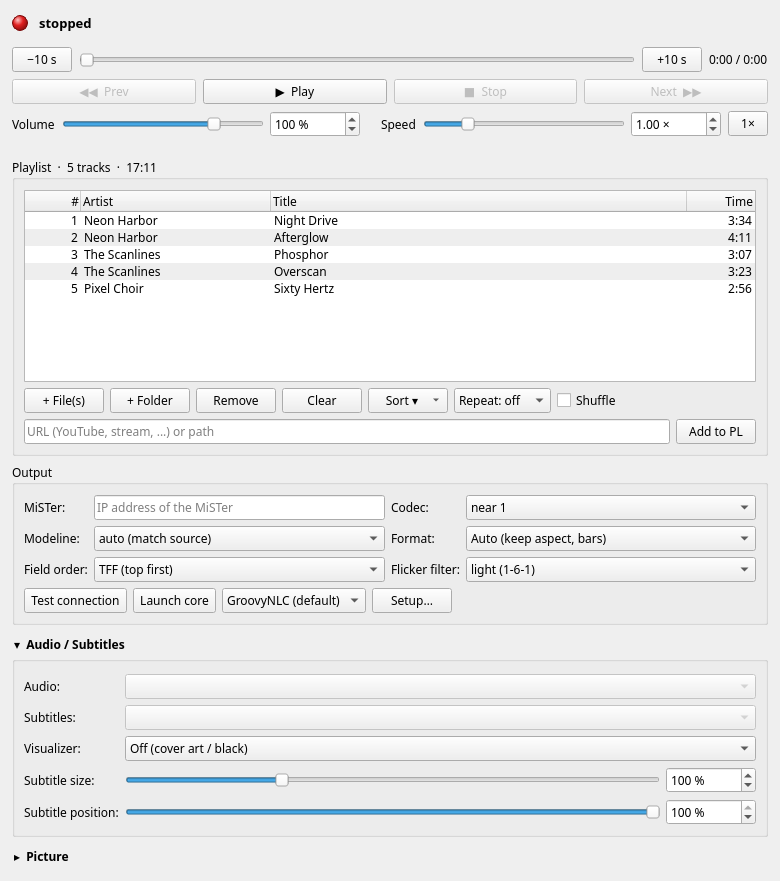
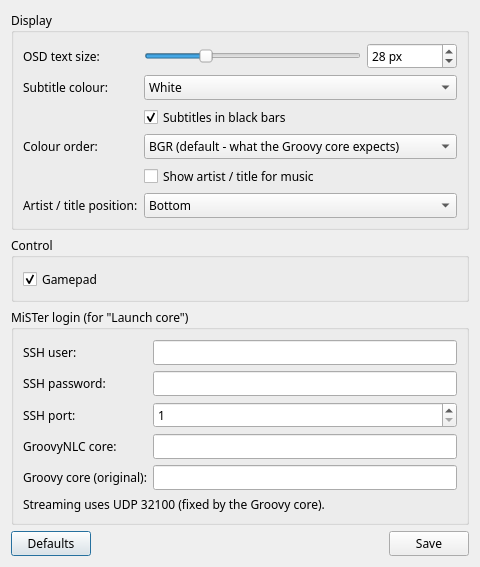
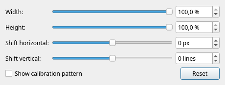
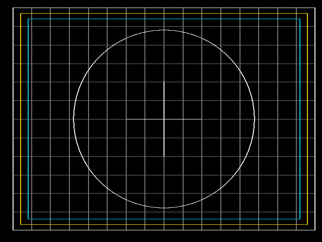
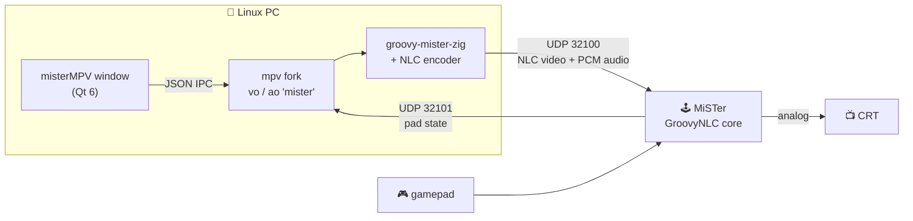

<div align="center">

# 📺 misterMPV

### A "Winamp-style" media player that plays straight onto your MiSTer's CRT

[](https://mpv.io)
[](https://github.com/MiSTer-devel/Main_MiSTer/wiki)
[](https://github.com/verbst/Groovy_MiSTer)
[](https://www.qt.io)
[](https://ziglang.org)
[](#-what-you-need)
[](#-license--credits)


</div>

**misterMPV** is [mpv](https://mpv.io) with a video and audio output that talks to a **MiSTer FPGA**: every frame is
compressed with the *GroovyNLC* codec and sent over UDP at the CRT's own timing (240p / 480i / 576i), audio goes along
as 48 kHz PCM. On top sits a Qt control window styled like a classic Winamp - playlist table, transport, volume and
speed, picture controls, CRT calibration, visualizers - and the **MiSTer's own gamepad** controls the player, with
status text on the TV.

> 🧭 **New here?** Jump to [Quick start](#-quick-start). **Wondering why this is a whole mpv fork?** See the
> [FAQ](#-faq).

---

## 📑 Contents

[Features](#-features) · [Screenshots](#-screenshots) · [What you need](#-what-you-need) ·
[Quick start](#-quick-start) · [Controls](#-controls) · [How it works](#-how-it-works) ·
[Where our code lives](#-where-our-code-lives) · [FAQ](#-faq) · [Docs](#-more-docs) ·
[License & credits](#-license--credits)

---

## ✨ Features

| | |
|---|---|
| 🎞️ **Straight to the CRT** | `auto` modeline picks 240p / 288p / 480i / 576i from the source, TFF/BFF field order, **flicker filter** for interlaced modes, NLC lossless or near-lossless |
| 🎨 **Picture controls** | brightness, contrast, saturation, black level, **4 scanline styles**, aspect modes (auto / stretch / zoom / 4:3 / 16:9 / 21:9), all live |
| 📐 **CRT calibration** | picture size and position for your set's overscan, with an on-screen test pattern |
| 🎮 **MiSTer gamepad** | seek, scan, volume, pause, next/previous, audio and subtitle track, status on the TV |
| 📜 **Playlist like Winamp** | table `# · Artist · Title · Album · Time`, click a header to sort, drag & drop, right-click menu (*play next*!), folders added recursively, shuffle that keeps the list order, repeat off/one/all |
| 🏷️ **Tags & durations** | read in the background with `ffprobe` and cached; artist falls back to the folder structure |
| 🔊 **Audio extras** | volume to 130 %, speed 0.25-4×, **visualizers** for music (spectrum, waves, vectorscope, spectrogram, bars), permanent **artist / title overlay** |
| 💬 **Subtitles** | size, position, colour, "in the black bars" for letterboxed films |
| 🌐 **Streams & shares** | YouTube/stream URLs (via yt-dlp), SMB/SFTP shares through KDE's kio-fuse |
| 🚦 **Status LED**, remembered window, keyboard shortcuts, "Launch core" and "Test connection" for the MiSTer | |

## 🖼️ Screenshots

<table>
<tr>
<td width="50%"><b>Playlist, picture, transport</b><br></td>
<td width="50%"><b>Audio / subtitles / visualizer</b><br></td>
</tr>
<tr>
<td><b>Setup</b> (OSD size, subtitle colour, colour order, gamepad, SSH login for <i>Launch core</i>)<br></td>
<td><b>CRT calibration</b> dialog<br><br><br>
<b>Test pattern on the CRT</b> (white edge = picture border, yellow/cyan = 95 % / 90 % safe areas)<br></td>
</tr>
<tr>
<td><b>Right-click on a track</b><br><br><br><b>Sort menu</b><br></td>
<td><b>Status LED</b> - red stopped · yellow starting · green playing · blue paused<br></td>
</tr>
</table>

## 🧰 What you need

- 🕹️ A **MiSTer** with the **GroovyNLC** core (`/media/fat/_Utility/GroovyNLC_*.rbf`) and a **CRT** on its analog
  output. Core OSD: *Volatile framebuffer = Off*, *CRT scale = Off*.
- 🐧 A **Linux** PC in the same LAN. Build tools: `meson` ≥ 1.3, `ninja`, `zig` ≥ 0.15.2 (tested 0.16), `cmake` + Qt 6
  base, a C/C++ compiler and mpv's usual dev libraries (ffmpeg, libass, luajit, ...). At runtime `ffprobe` (tags) and
  optionally `yt-dlp` (YouTube).
- ⚠️ **One sender per MiSTer.** Close MiSTerCast, RetroArch, `mister-groovy-relay` or another mpv first, otherwise the
  FPGA stalls.

## 🚀 Quick start

```sh
git clone git@github.com:tdslaine/MisterMPV.git && cd MisterMPV

meson setup build -Dlua=luajit -Dlibmpv=false -Dmanpage-build=disabled -Dtests=false
ninja -C build                                            # -> build/mpv
cmake -S mister-ui -B mister-ui/build -G Ninja && ninja -C mister-ui/build   # -> mister-ui/build/misterMPV
```

Everything is in the repo (the protocol library is in `third_party/` and gets built by meson on the first
configure; checked from a fresh `git clone`).

```sh
mister-ui/build/misterMPV                        # open the player
mister-ui/build/misterMPV song.mp3 ~/Music/Album/    # or add files / folders and play right away
```

1. Type the MiSTer's IP into **Output → MiSTer**.
2. Core not loaded yet? **Launch core** (SSH, login in **Setup…**; stock MiSTer is `root` / `1`), then **Test connection**.
3. **+ File(s) / + Folder** (or drop files on the list, or paste a YouTube URL) → **Play**.

No window needed - plain mpv works too:

```sh
build/mpv --vo=mister --ao=mister --vo-mister-host=<MiSTer IP> --vo-mister-modeline=auto movie.mkv
```

`mister-ui` finds `mpv` next to itself, then in `../../build/mpv`, or via `$MPV_MISTER`; the MiSTer address can also
come from `$MISTER_HOST`.

## 🎛️ Controls

<table>
<tr><th>⌨️ Keyboard</th><th>🎮 MiSTer gamepad</th></tr>
<tr><td>

| Key | |
|---|---|
| `Space` / `C` | play / pause |
| `X` | play (restart) |
| `V` | stop |
| `Z` / `B` | previous / next |
| `M` | mute |
| `Ctrl` + `←` `→` | seek 10 s (`+Shift`: 60 s) |
| `Ctrl` + `↑` `↓` | volume |
| `Del` / `Enter` (list) | remove / play |

</td><td>

| Button | |
|---|---|
| D-pad ← → | seek 10 s, **hold = scan** |
| D-pad ↑ ↓ | volume |
| B1 / Start | pause |
| B2 | quit |
| B3 / B4 | audio / subtitle track |
| L1 / R1 | previous / next |
| L2 / R2 | seek ∓60 s |
| Select | status on the TV |

</td></tr>
</table>

Buttons without a function flash `Pad button 0x....` on the TV, so the mapping is easy to extend
(`video/out/mister_pad.c`).

## 🔧 How it works



- mpv decodes, scales to the CRT raster and draws subtitles/OSD as usual; `vo_mister` hands each frame to **one
  sender thread** that repeats the last frame at the CRT's rate, splits interlaced frames into fields (flicker filter
  first), applies the picture effects, NLC-encodes and sends it. That is why effects keep working while paused.
- The **modeline** is switched by reconnecting; `auto` decides after ~8 frames from the source frame rate/height.
- The **UI** is a separate Qt program that starts mpv and steers it over its JSON IPC socket, so the player itself
  stays a normal mpv.
- **Shuffle, visualizers and the artist/title overlay** are small Lua scripts compiled into the binary.

Details and every option: [MISTER.md](MISTER.md).

## 🗺️ Where our code lives

The fork changes only a handful of mpv lines; everything else is new files.

| Path | What |
|---|---|
| `video/out/vo_mister.c`, `mister_conn.c/.h` | video output, shared sender thread, picture effects |
| `video/out/mister_calib.c/.h` | CRT calibration + test pattern |
| `video/out/mister_pad.c/.h` | gamepad → mpv commands |
| `video/out/nlc_codec.cpp/.h`, `mister_modelines.inc` | NLC encoder, modeline table |
| `audio/out/ao_mister.c` | audio output |
| `player/lua/mister_playlist.lua`, `mister_visualizer.lua` | shuffle, next/previous, visualizer, overlay |
| `mister-ui/` | the Qt window (+ `screenshots/`) |
| `third_party/groovy-mister-zig/` | MiSTer protocol library (Zig) |
| hooks into mpv | `video/out/vo.c`, `audio/out/ao.c`, `options/options.c/.h`, `player/{core.h,lua.c,scripting.c}`, `meson.build` |

## ❓ FAQ

<details>
<summary><b>Why do we need the whole mpv?! 🤯</b></summary>

Because a video/audio output has to live **inside** the player. mpv has no plug-in interface for outputs - the ones
you know (`gpu`, `x11`, `pipewire`, ...) are compiled into the binary. So to get "mpv, but the picture goes to a
MiSTer" there are three ways:

1. **Fork mpv and add `--vo=mister` / `--ao=mister`** (what we did). Plain `mpv` works with it, subtitles/OSD/
   scaling/filters/yt-dlp/scripting all come for free, audio and video stay in sync inside the player. Cost: the repo
   contains all of mpv.
2. **Write an app around `libmpv`** and render into memory with its software render API. No fork, but then audio has
   to be tapped some other way, the OSD/subtitle path has to be rebuilt, and nothing works from the command line.
3. **Keep only our patches** in a small repo and let a script fetch mpv. Slimmer to browse, but every mpv release
   needs patch maintenance and a build needs two steps.

The repo *looks* huge because it carries mpv's history (~54 000 commits, ~120 MB once). Our own part is **27 files**
(plus the vendored protocol library) and only a few lines inside mpv itself, so merging a new mpv is
`git fetch origin && git merge origin/master`. If it ever bothers you, option 3 is a few hours of work.
</details>

<details>
<summary><b>The picture stalls / "FPGA stalled, reconnecting"</b></summary>

Almost always a second sender: MiSTerCast, RetroArch, `mister-groovy-relay` (it probes the MiSTer even while idle) or
an old mpv. Stop it. Otherwise: wrong IP, the core is not loaded (use **Launch core**), or the network drops UDP.
</details>

<details>
<summary><b>The colours are blue / red-tinted</b></summary>

The core expects B,G,R. If a core ever wants R,G,B, flip **Setup… → Colour order**.
</details>

<details>
<summary><b>Does it work with the original Groovy core?</b></summary>

No - misterMPV streams with the NLC codec, which only the GroovyNLC core decodes.
</details>

<details>
<summary><b>Windows / macOS?</b></summary>

Not tested; developed and used on Linux (Arch/KDE). The Zig library is cross-platform, mpv too, so a port is
plausible, the Qt window and the kio-fuse bits are the Linux-specific parts.
</details>

<details>
<summary><b>How do I update mpv?</b></summary>

`git fetch origin && git merge origin/master`, then `meson setup --wipe build` and rebuild. Conflicts can only be in the few
hook lines listed above.
</details>

## 📚 More docs

- 📖 [MISTER.md](MISTER.md) - all options, scripts, gamepad bits, UI details
- 🧑‍💻 [HANDOFF.md](HANDOFF.md) - status, decisions, traps and open points (**read before changing things**)
- 🙏 [CREDITS.md](CREDITS.md) - who made what we build on
- 📄 [README-mpv.md](README-mpv.md) - mpv's own README

## ⚖️ License & credits

misterMPV is **free software under the GPL**: mpv itself is GPLv2+ (libmpv LGPLv2.1+), the vendored
`groovy-mister-zig` and the NLC codec are GPL as well; see `LICENSE.GPL`, `LICENSE.LGPL`, `Copyright` and
`third_party/groovy-mister-zig/LICENSE`.

Big thanks to everyone whose work this stands on - the full list with links is in **[CREDITS.md](CREDITS.md)**:
**mpv**, **psakhis** (Groovy_MiSTer core and protocol), **verbst** (GroovyNLC core and NLC codec), **iequalshane**
(MiSTerCast), **dylan** (groovy-mister-zig), **idio-sync** (MiSTer_GroovyRelay), **jedisct1** (zig-lz4) and the
FFmpeg, libass, LuaJIT, Qt, Zig and yt-dlp projects.

<sub>"Winamp" is a trademark of its owner; this project is only inspired by its layout and is not affiliated with it.
Developed with the help of Claude Code (Anthropic).</sub>
