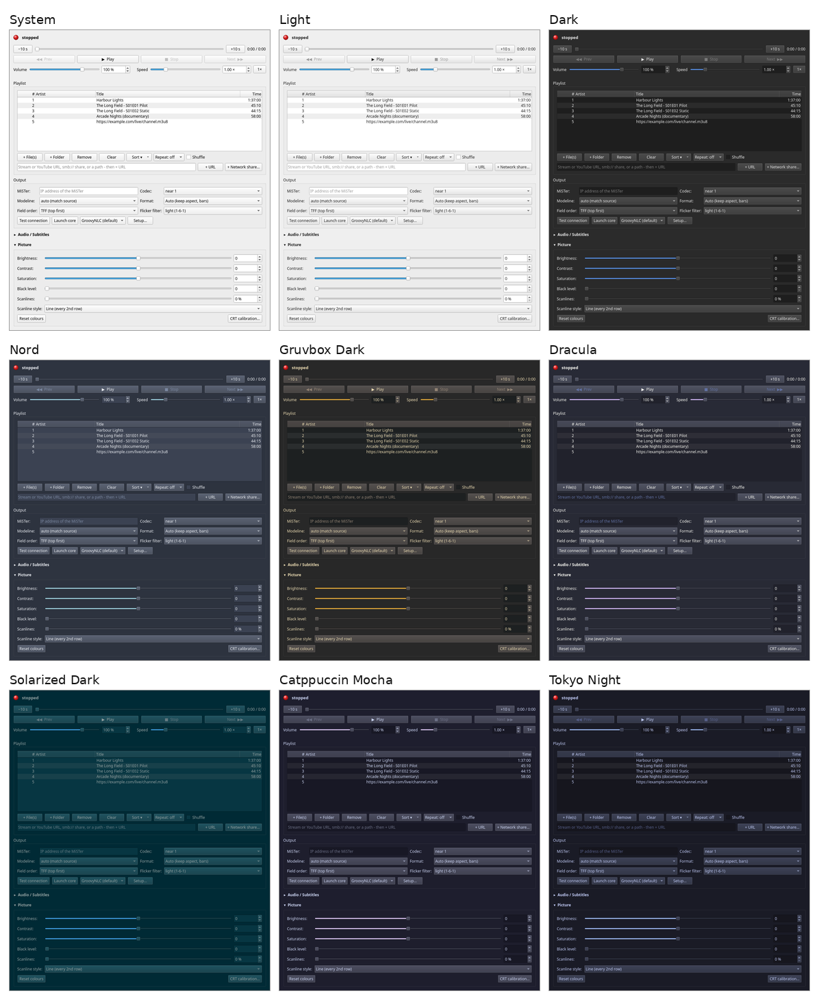
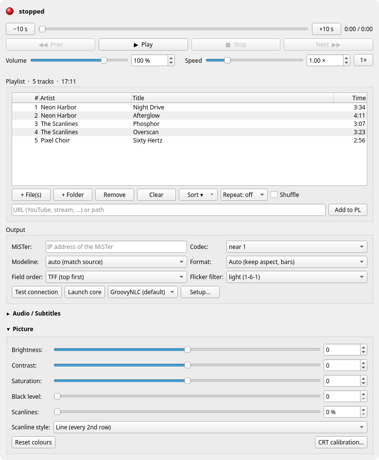
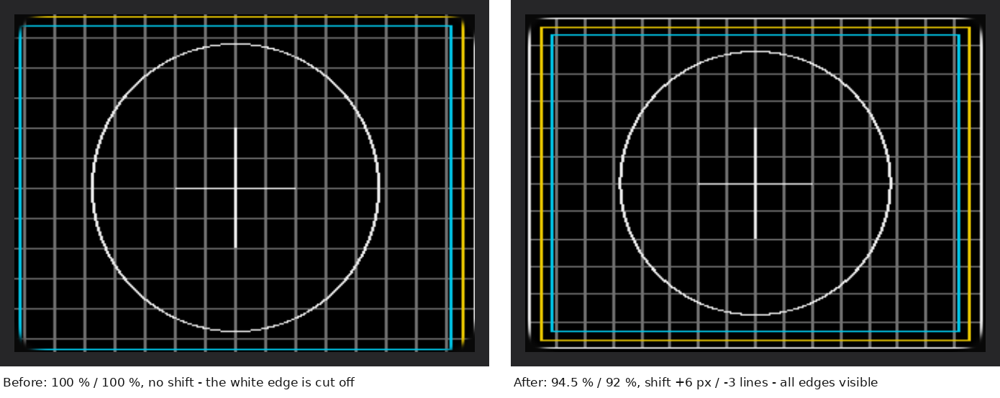
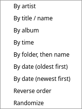
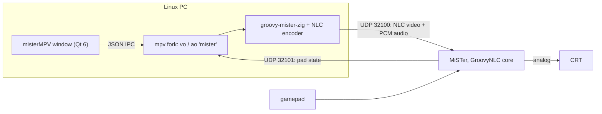

# misterMPV

A video player for the CRT on your MiSTer: films, series, YouTube, live streams and music, played by
[mpv](https://mpv.io) with a video and audio output that streams to a MiSTer FPGA running the
[GroovyNLC core](https://github.com/verbst/Groovy_MiSTer), plus a control window with a playlist.

[](https://mpv.io)
[](https://github.com/verbst/Groovy_MiSTer)
[](#requirements)
[](#license)


Every video frame is scaled to a real 15 kHz mode (240p, 288p, 480i, 576i), compressed with the NLC codec and sent over
UDP to the MiSTer at the CRT's own timing; audio is sent as 48 kHz PCM. Local files, folders, network shares, stream URLs
and YouTube links go into one playlist. Subtitles, audio tracks and the rest of mpv come along. The MiSTer's gamepad
controls the player and shows status text on the TV.

## About

misterMPV is a video player that casts from a Linux PC to a MiSTer and its CRT. I built it because none of the
existing ways to get films, series and YouTube onto my CRT really suited me, and on Linux there was nothing usable at
all. So I took mpv, gave it an output for the GroovyNLC core and put a small window on top. I use it on my own MiSTer
and CRT.

I did not build it alone: Claude AI agents (my "Claude minions") wrote much of the code and the documentation with me,
under my direction and tested on my own MiSTer and CRT.

## Contents

1. [Requirements](#requirements)
2. [Prepare the MiSTer: the GroovyNLC core](#prepare-the-mister-the-groovynlc-core)
3. [Installation](#installation)
4. [First start](#first-start)
5. [Setup: MiSTer login and Launch core](#setup-mister-login-and-launch-core)
6. [Adding media: files, folders, streams, YouTube, network shares](#adding-media-files-folders-streams-youtube-network-shares)
7. [Using the player](#using-the-player)
8. [Subtitles, audio tracks and other mpv features](#subtitles-audio-tracks-and-other-mpv-features)
9. [CRT geometry and calibration](#crt-geometry-and-calibration)
10. [Features](#features)
11. [Screenshots](#screenshots)
12. [How it works](#how-it-works)
13. [Repository layout](#repository-layout)
14. [FAQ](#faq)
15. [Thanks](#thanks)
16. [Documentation, credits, license](#documentation-credits-license)

## Requirements

**On the MiSTer**

- The **GroovyNLC core** by verbst, installed as described in the next section. It is **essential**: without it there is
  nothing on the MiSTer that can receive the stream. Project and downloads:
  **[github.com/verbst/Groovy_MiSTer](https://github.com/verbst/Groovy_MiSTer)** (releases:
  [verbst/Groovy_MiSTer/releases](https://github.com/verbst/Groovy_MiSTer/releases)).
- A CRT on the analog output, and Gigabit Ethernet between the PC and the MiSTer (a switch is fine, Wi-Fi is not).

**On the PC** (Linux, same LAN as the MiSTer)

- Build tools: `meson` (1.3 or newer), `ninja`, `zig` 0.15.2 or 0.16 (zig 0.17 cannot build the vendored protocol library yet), `cmake`, Qt 6 base, a C/C++
  compiler, and mpv's usual development libraries (ffmpeg, libass, luajit, ...).
- At runtime: `ffprobe` for tags and durations, optionally `yt-dlp` for YouTube and `jellyfin-mpv-shim` (3.x) for
  the Jellyfin receiver.

Only one program may stream to the MiSTer at a time. Close MiSTerCast, RetroArch, `mister-groovy-relay` or another mpv
first, otherwise the picture stalls.

## Prepare the MiSTer: the GroovyNLC core

misterMPV only talks to the **GroovyNLC** core, a fork of psakhis' Groovy core that adds the near-lossless NLC codec (what
makes 480i/480p stable over Ethernet; see [Why NLC?](#why-nlc-and-the-groovynlc-core) in the FAQ). The original **Groovy** core ([psakhis/Groovy_MiSTer](https://github.com/psakhis/Groovy_MiSTer))
cannot decode NLC. Everything below is summarised from the core's own
[README](https://github.com/verbst/Groovy_MiSTer#install); check it for newer versions and details.

1. Download the latest release from
   [verbst/Groovy_MiSTer/releases](https://github.com/verbst/Groovy_MiSTer/releases). Copy `GroovyNLC_*.rbf` to
   `/media/fat/_Utility` and `MiSTer_groovyNLC` to `/media/fat` (FTP: binary mode).
2. Add this to `/media/fat/MiSTer.ini` (the section name must be `GroovyNLC`, the core's name, not the file name):

   ```ini
   [GroovyNLC]
   main=MiSTer_groovyNLC
   ```

3. Start the core from the `_Utility` menu. A bouncing logo means it is running and waiting for a client. (Later you
   can start it from misterMPV with **Launch core**, which loads the newest `GroovyNLC_*.rbf` over SSH.)
4. In the core's OSD set **Volatile framebuffer = Off** (required for NLC) and **CRT scale = Off**.

The core listens on UDP **32100** (video, audio, control) and **32101** (controller). Give the PC and the MiSTer static IP
addresses. If the picture stays black or garbled, the core's troubleshooting section lists the usual causes (old
`MiSTer_groovyNLC` binary, Volatile framebuffer on, ...).

Related projects you might know: [verbst/MiSTerCast](https://github.com/verbst/MiSTerCast) (Windows desktop mirroring
with NLC) and [verbst/RetroArch](https://github.com/verbst/RetroArch) (RetroArch with a native MiSTer output).

## Installation

**Ready-made:** the [releases](https://github.com/tdslaine/MisterMPV/releases) have an **AppImage** for x86_64 Linux
(built on Ubuntu 22.04, runs on most current distributions) and a tarball for Arch/CachyOS. For the AppImage:
`chmod +x misterMPV-*-x86_64.AppImage` and start it. It contains the player, the window and `ffprobe`; `yt-dlp`,
`kio-fuse` and `jellyfin-mpv-shim` are optional and come from your distribution. How it is built:
[packaging/appimage](packaging/appimage/README.md).

**From source:**

```sh
git clone https://github.com/tdslaine/MisterMPV.git
cd MisterMPV

meson setup build -Dlua=luajit -Dlibmpv=false -Dmanpage-build=disabled -Dtests=false
ninja -C build                                   # player:  build/mpv
cmake -S mister-ui -B mister-ui/build -G Ninja
ninja -C mister-ui/build                         # window:  mister-ui/build/misterMPV
```

The repository is self-contained: the MiSTer protocol library is in `third_party/` and meson builds it on the first
configure (checked from a fresh clone). If meson is not installed: `python3 -m venv v && v/bin/pip install meson`.
After moving the folder, run `meson setup --wipe build` again.

`mister-ui` looks for `mpv` next to itself, then in `../../build/mpv`; `$MPV_MISTER` overrides it. To "install", copy both
binaries into one folder.

## First start

```sh
mister-ui/build/misterMPV
```

(or start the AppImage)

1. Enter the MiSTer's IP address under **Output → MiSTer** (or set `$MISTER_HOST`).
2. Enter the login in **Setup… → MiSTer login** (see the next section; a stock MiSTer is `root` / `1`), press
   **Launch core**, wait a few seconds, then press **Test connection**: it should say *MiSTer answered*.
3. Add media: **+ File(s)**, **+ Folder**, drag files onto the list, or paste a stream or YouTube URL and press
   **+ URL** (details in [Adding media](#adding-media-files-folders-streams-youtube-network-shares)).
4. Press **Play**, or double-click an entry.

Files can also be given on the command line: `misterMPV film.mkv ~/Videos/Series/` adds them and starts playing.

Without the window, the player alone works as well:

```sh
build/mpv --vo=mister --ao=mister --vo-mister-host=<MiSTer IP> --vo-mister-modeline=auto movie.mkv
```

## Setup: MiSTer login and Launch core


**Launch core** starts the GroovyNLC core on the MiSTer without touching the MiSTer menu. It logs in with SSH,
picks the newest file that matches the core path and writes `load_core <file>` to `/dev/MiSTer_cmd`, which is how the
MiSTer itself loads cores. Everything it needs is in **Setup… → MiSTer login (for "Launch core")**:

| Field | Meaning | Stock MiSTer |
|---|---|---|
| SSH host | only if SSH should go to another address; empty = the MiSTer IP from **Output → MiSTer** | empty |
| SSH user | login name | `root` |
| SSH password | login password; leave it empty if you log in with a key | `1` |
| SSH key file | optional private key, e.g. `~/.ssh/id_ed25519` | empty |
| SSH port | SSH port | `22` |
| GroovyNLC core | path or wildcard of the core file on the MiSTer; the newest match is loaded | `/media/fat/_Utility/GroovyNLC_*.rbf` |
| Groovy core (original) | the same for psakhis' original Groovy core | `/media/fat/_Utility/Groovy_*.rbf` |

The login fields start empty: misterMPV has no built-in user name or password, the grey text only shows what a stock
MiSTer uses. The core paths fall back to the stock paths shown in grey when they are empty. **Test login** logs in with
the values as they are in the dialog and shows which core files **Launch core** would load (or that none matches).
**Defaults** empties the fields, **Save** stores them. The selector next to
**Launch core** in the main window decides which of the two cores is loaded. Use *GroovyNLC* for misterMPV; the
original core is only there so you can switch the MiSTer back to it for other programs (misterMPV cannot stream to it).
If the core file is in another folder, enter that path, for example `/media/fat/_Utility/GroovyNLC_20260712.rbf` or
`/media/fat/cores/GroovyNLC_*.rbf`. If no file matches, the status line says so.

**Test connection** asks the core on UDP port 32100 for its protocol version and reports *GroovyNLC core answered
… - ready*, a hint if only the original Groovy core is running, or *No reply* if no core is loaded or the IP is
wrong. It needs no SSH. While misterMPV is streaming it does not test (the core serves one sender at a time) and
just says that the connection is evidently working; press Stop first to run the test.

**Where the login is stored, keys and host key.** The login and the core paths are stored only on your PC, in
`~/.config/mistercast/misterMPV-login.conf`, which misterMPV keeps readable only by you (`chmod 600`). The password is
stored there as plain text, so prefer a key if you can. Older versions kept the login in the general settings file;
misterMPV moves it over on the first start. Nothing of it is part of the repository or a release.
misterMPV runs the normal `ssh` program: with an empty password it only uses keys (the key file from Setup, or your
default keys and a running `ssh-agent`) and never waits for a prompt; with a password, keys are still tried first.
The password is handed to `ssh` through a short-lived helper script, never on the command line. The MiSTer's host key
is remembered on the first login in `~/.config/mistercast/misterMPV-known_hosts`. If it changes later (new SD card,
reinstall), the login is refused with a hint; delete that file if the change is expected.

## Adding media: files, folders, streams, YouTube, network shares


| How | What happens |
|---|---|
| **+ File(s)** | pick one or more files |
| **+ Folder** | adds every video and audio file in the folder and its subfolders, sorted by name (up to 5000 files) |
| drag and drop | drop files or folders from a file manager onto the list |
| URL box + **+ URL** (or Enter) | a stream URL, a YouTube link, an `smb://` address or a local path (a folder is scanned like **+ Folder**) |
| **+ Network share…** | asks for an `smb://` address of a folder or file and mounts it through kio-fuse |
| command line | `misterMPV film.mkv ~/Videos/Series/` |

Recognised file types: `mkv mp4 avi mov webm mpg mpeg ts m2ts wmv flv m4v ogv vob` (video) and
`mp3 flac ogg opus wav m4a aac wma ape mka` (audio). The table shows the title tag (or the file name) and the running
time, read in the background with `ffprobe`.

**Streams.** Paste the URL, for example `https://example.com/live/channel.m3u8` (HLS) or a direct `http(s)://` link to a
video file, into the URL box and press **+ URL**.

**YouTube** (and the other sites `yt-dlp` knows). Paste the video or playlist link the same way. mpv hands it to
[yt-dlp](https://github.com/yt-dlp/yt-dlp), which therefore has to be installed and on the `PATH`; check with
`yt-dlp --version`. Without yt-dlp misterMPV does not add the link and says how to install yt-dlp. YouTube changes
often, so keep yt-dlp current (distribution package, `pipx upgrade yt-dlp` or `yt-dlp -U`). Picture quality is no
problem: everything is scaled down to the CRT mode anyway.

**Network shares (SMB) with kio-fuse.** mpv cannot open `smb://` itself. On KDE with
[kio-fuse](https://invent.kde.org/system/kio-fuse) installed (`kio-fuse` package), misterMPV turns network URLs into
local paths:

- press **+ Network share…** and enter the address of a folder or a file, for example `smb://server/Videos/Films`
  (a folder is added with all its videos, like **+ Folder**); or
- paste such an address into the URL box and press **+ URL**; or
- on KDE, open *Network* in **+ File(s)** / **+ Folder** (or type `smb://server/share` into the path bar).

If kio-fuse is missing, **+ Network share…** says so and points to the alternative below.

misterMPV asks kio-fuse (over D-Bus) to mount the share and plays it from there; after a reboot it mounts it again
by itself. The share's user name and password are asked for and kept by KDE (KWallet), not by misterMPV, so there is
nothing to put in a config file. `smb://user@server/share` selects the user. An address with a password in it is
refused, because playlist entries are saved as plain text.

Without kio-fuse (it is part of KDE), mount the share with the usual tools and
add the mounted folder with **+ Folder**. For example with GNOME/GVfs: `gio mount smb://server/Videos`, then the folder
`/run/user/$(id -u)/gvfs/smb-share:server=server,share=videos`. Or with a CIFS mount in `/etc/fstab` whose password
lives in a separate credentials file that only root can read:

```
# /etc/fstab
//server/Videos  /mnt/videos  cifs  credentials=/etc/samba/videos.cred,uid=1000,gid=1000,ro,noauto,x-systemd.automount  0 0
```

```
# /etc/samba/videos.cred   (chmod 600, owner root)
username=<user>
password=<password>
```

## Using the player

**Transport.** Prev, Play/Pause, Stop, Next; the seek bar has -10 s / +10 s at its ends; volume (up to 130 %) and speed
(0.25x to 4x) below. The coloured lamp shows the state: red stopped, yellow starting, green playing, blue paused.

**Playlist.** A table with `#`, `Artist`, `Title`, `Album` (hidden by default; right-click the header to show it) and
`Time`. Click a header to sort, click again to reverse. Drag rows to reorder, drop files from a file manager onto it.
Right-click a row for *Play now*, *Play next*, *Move to end*, *Remove*, *Open containing folder*, *Copy path*.
`Sort` has artist, title, album, time, folder, date, reverse and random. `Repeat` is off / one / all; `Shuffle` picks
the next track randomly but keeps the list order.

**Output and picture.** Modeline (`auto` follows the source), field order, flicker filter, aspect, and the
**Codec**: *lossless* (NLC near 0) or *near 1* to *near 3*. Higher levels need less bandwidth and lose a little fine
detail; *near 1* is the default and a good choice on Gigabit Ethernet. In the collapsible
*Audio / Subtitles* and *Picture* sections: track selection, subtitle size and position, visualizer for music;
brightness, contrast, saturation, black level, scanlines (four styles) and **CRT calibration** (picture size and shift
for your set's overscan, with a test pattern). **Setup…** holds the rarely changed options: OSD text size, subtitle
colour, "subtitles in the black bars", artist/title overlay for music, colour order, gamepad on/off, SSH login.

**Themes.** **Setup… → Display → Theme** changes the window's colours at once: *System* (your desktop's style, the
default), *Light*, *Dark*, *Nord*, *Gruvbox Dark*, *Dracula*, *Solarized Dark*, *Catppuccin Mocha* and *Tokyo Night*.
Apart from *System* they use Qt's Fusion style, so they look the same on every desktop and in the AppImage. The status
lamp keeps its colours, because they mean something.



**Keyboard**

| Key | Action |
|---|---|
| `Space`, `C` | play / pause |
| `X` | play (restart) |
| `V` | stop |
| `Z`, `B` | previous, next |
| `M` | mute |
| `Ctrl` + `Left` / `Right` | seek 10 s (with `Shift`: 60 s) |
| `Ctrl` + `Up` / `Down` | volume |
| `Del`, `Enter` (in the list) | remove, play |

**MiSTer gamepad**

| Button | Action |
|---|---|
| D-pad left / right | seek 10 s, hold to scan |
| D-pad up / down | volume |
| B1, Start | pause |
| B2 | quit |
| B3, B4 | next audio track, next subtitle track |
| L1, R1 | previous, next |
| L2, R2 | seek -60 s, +60 s |
| Select | status on the TV |

A button without a function flashes `Pad button 0x....` on the TV, which makes it easy to extend the mapping
(`video/out/mister_pad.c`).

If the pad does nothing, check both ends:

- **On the MiSTer**, in the GroovyNLC core's OSD (open it with the OSD button or F12 while the core runs):
  **Joysticks** must be *Digital* or *Analog*, not *Off*. *Analog* is the default on a fresh install. If you came from the
  original Groovy core and the pad is ignored, the core's settings may not have carried over; see the core's
  [troubleshooting notes](https://github.com/verbst/Groovy_MiSTer#troubleshooting).
- misterMPV reads **player 1** only. If several pads are connected, use *OSD → Controllers → Reassign players* and press
  a button on the pad you want first. The buttons above are the core's standard positions; a remapped profile on the
  Controllers page moves them accordingly.
- **In misterMPV**, **Setup… → Control → Gamepad** must be ticked. The pad works only while misterMPV is streaming
  (the core sends pad input to the program connected to it), and only one program can be connected at a time.

**Jellyfin receiver (casting and SyncPlay).** With `jellyfin-mpv-shim` installed, misterMPV can show up in Jellyfin
as a cast target, also for watching together with SyncPlay. In **Setup… → Jellyfin receiver** tick *Receive casts*,
pick a device name (default `MiSTer`), check the server address (taken from your normal shim if you have one) and
press **Sign in (Quick Connect)**: a code appears, enter it in Jellyfin under user menu → *Quick Connect*. From then on
the receiver starts with misterMPV and stops when you close it; in Jellyfin choose the device name in the cast menu.

- It is a private shim instance with its own login and device id in `~/.config/mistercast/jellyfin/`, so it never
  gets in the way of a jellyfin-mpv-shim you run for the PC screen. Its library browser is off; control playback from
  the Jellyfin app or web page (or the MiSTer gamepad).
- It uses the same output and picture settings as local playback (modeline, codec, field order, OSD, subtitles,
  brightness, scanlines, calibration); changes in the window apply to it too.
- Idle it sends nothing to the MiSTer. Starting a playlist entry in misterMPV (double-click / Enter) stops a running
  cast, and a new cast stops local playback, so there is only ever one sender. The status line shows
  `Jellyfin ▶ <title>` while a cast plays.
- While a cast plays, the window's transport controls it: Play/Pause, Stop, Prev/Next (the Jellyfin queue), seek bar,
  -10/+10 s, volume, speed, audio and subtitle track, and the keyboard shortcuts. Pause, Stop and Prev/Next go through
  the shim's own keys, so a SyncPlay group follows them; seek-bar jumps are passed on to the group as well, but the
  shim ignores jumps of 10 s or less there (same as with its own keyboard), so -10/+10 s only moves your screen until
  SyncPlay pulls it back. Volume and tracks stay local.
- Subtitle position: the shim itself only knows top / middle / bottom and applies it on every file, so casts use the
  nearest of those.

## Subtitles, audio tracks and other mpv features

misterMPV is mpv, so mpv's playback features work. Which of them you reach depends on how you start it.

**In the window** (checked with v0.2.1):

| Feature | Where |
|---|---|
| audio track | **Audio / Subtitles → Audio** while playing (MiSTer gamepad: B3) |
| subtitle track, off | **Audio / Subtitles → Subtitles** (gamepad: B4) |
| subtitle size and position | **Audio / Subtitles**, sliders |
| subtitle colour, subtitles in the black bars of letterboxed films | **Setup… → Display** |
| external subtitles | a `.srt`/`.ass` file next to the video with the same name (or the name plus a language, e.g. `film.en.srt`) is loaded automatically |
| seek, speed, volume, pause | transport row, seek bar, keyboard shortcuts above, gamepad |
| aspect: auto, stretch, zoom, 4:3, 16:9, 21:9 | **Output → Format** |
| Jellyfin casting and SyncPlay | **Setup… → Jellyfin receiver** (see above) |

The window starts mpv with `--no-config`, so your own `mpv.conf`, `input.conf` and scripts do not apply there, and
mpv's own hotkeys do not reach it (there is no mpv window to type into); use the window's shortcuts and the gamepad.

**mpv started directly** from a terminal gives you all of mpv, with its own keys. Example:

```sh
mpv --vo=mister --ao=mister --vo-mister-host=<MiSTer IP> --ao-mister-host=<MiSTer IP> --vo-mister-modeline=auto film.mkv
```

Or put it into a profile in `~/.config/mpv/mpv.conf` and run `mpv --profile=mister film.mkv`:

```ini
[mister]
vo=mister
ao=mister
vo-mister-host=<MiSTer IP>
ao-mister-host=<MiSTer IP>
vo-mister-modeline=auto
sub-auto=fuzzy
```

Keys that were checked in this build (mpv's defaults):

| Key | Action |
|---|---|
| `Space` / `p` | pause |
| `Left` / `Right`, `Down` / `Up` | seek back / forward (short, 1 minute) |
| `PgUp` / `PgDn` | next / previous chapter |
| `[` / `]`, `Backspace` | slower / faster, normal speed |
| `#` | next audio track |
| `j` / `J` | next / previous subtitle track |
| `v` | subtitles on / off |
| `z` / `Z` (or `x`) | subtitle delay -0.1 s / +0.1 s |
| `Ctrl` + `+` / `Ctrl` + `-` | audio delay +0.1 s / -0.1 s |
| `r` / `R` | subtitles up / down |
| `F` / `G` | subtitles smaller / larger |
| `d` | deinterlace on / off |
| `q` | quit |

Useful options for the CRT, also checked: `--sub-file=film.de.srt` (load a subtitle file; at runtime `sub-add`),
`--deinterlace=yes` or `--vf=yadif` (for interlaced sources such as DVDs and TV recordings shown in a progressive mode;
for the 480i/576i modes use the field order and flicker filter instead), `--sws-scaler=lanczos` (the scaler used to
fit the picture to the CRT mode; `bicubic` is the default) and every option in [MISTER.md](MISTER.md). Your own Lua
scripts in `~/.config/mpv/scripts` load as usual. With the AppImage, unpack it once
(`./misterMPV-*.AppImage --appimage-extract`) and run `squashfs-root/usr/bin/mpv`.

## CRT geometry and calibration

What fills the screen is decided in four places:

- **Modeline** (**Output → Modeline**): the 15 kHz mode the CRT receives. `auto` picks 240p/480i at 60 Hz or
  288p/576i at 50 Hz from the source's frame rate and height; a fixed mode can be chosen as well
  (256/320/720x240p60, 320/640/720x480i60, 256/320/720x288p50, 320/720x576i50).
- **Format** (**Output → Format**): how the picture is fitted into that mode (keep aspect with bars, stretch, zoom, or a
  fixed 4:3 / 16:9 / 21:9).
- **CRT calibration**: size and position inside the raster, so that nothing disappears behind the bezel. This is
  stored and applies to every mode, to local playback and to Jellyfin casts alike.
- **Modeline fine-tune** (in the same dialog): moves the sync pulse of one modeline, which shifts the whole picture on
  the CRT without scaling it or losing pixels. Stored per modeline.

The calibration dialog opens from **Picture → CRT calibration…** and from **Setup… → Picture on the CRT → CRT geometry…**.

Most CRTs overscan: the edges of the picture sit behind the bezel, and the visible area is often a little off centre.
The calibration scales and shifts the picture inside the 15 kHz raster so that all of it is visible. The values are
stored and apply to everything misterMPV plays, including Jellyfin casts.

1. Load any file and start playing it (the pattern replaces the video of a running file).
2. Open the **Picture** section and press **CRT calibration…**.

   

3. Tick **Show calibration pattern**. The CRT now shows a grid with a circle, a white frame at the picture edge and
   two inner frames for the 95 % (yellow) and 90 % (cyan) safe areas.

   

4. Reduce **Width** and **Height** (80-100 %) until the white frame is visible on all four sides, then use
   **Shift horizontal** (pixels) and **Shift vertical** (lines) to centre it. The circle should look round. In
   interlaced modes the vertical shift counts field lines.

   

5. Close the dialog (the pattern switches off) or untick the box. **Reset** returns to 100 % and no shift.

**Modeline fine-tune.** If the picture sits off centre on your set in one particular mode, move that mode itself
instead of shrinking the picture: choose the modeline in the lower part of the dialog and set **Horizontal** (pixels,
+ = right) and **Vertical** (lines, + = down). The change is applied live, so do it with the test pattern on and a file
in that mode playing. misterMPV keeps the sync inside the blanking interval, so the line and frame rates never change
and the values stop where the mode has no more room. With **Modeline = auto**, misterMPV uses 640x480i60 for most
films and series (320x240p60 for sources up to 240 lines), and 720x576i50 / 320x288p50 for 25/50 fps (PAL) sources;
adjust those you actually use. **Reset this modeline** returns it to the
stock timing. Without the window: `--mister-sync-shift=720x480i60:2:-1,320x240p60:0:1`.

What this looks like on a set that overscans and sits slightly to the left (simulated from the real test pattern):



Subtitles and the OSD are drawn inside the calibrated picture, so they do not end up behind the bezel either. Without the
window: `--mister-calibrate=yes` shows the pattern, the size and shift options are listed in [MISTER.md](MISTER.md).

## Features

- Video first: films, series, YouTube and live streams with subtitles, audio track selection and chapters (mpv);
  music works too.
- Output to the CRT: automatic modeline (25/50 fps to the 50 Hz modes, everything else 60 Hz), TFF/BFF field order,
  flicker filter for interlaced modes, NLC codec (lossless or near 1-3).
- Picture: brightness, contrast, saturation, black level, four scanline styles, aspect modes (auto, stretch, zoom, 4:3,
  16:9, 21:9), CRT size/position calibration with a test pattern.
- Gamepad control from the MiSTer with on-screen status.
- Winamp-style playlist: sortable table, drag and drop, recursive folders, right-click menu, shuffle that keeps the order,
  repeat modes, YouTube (yt-dlp) and stream URLs, SMB/SFTP shares through KDE's kio-fuse.
- Tags, durations and music handling: `ffprobe` in the background with a cache; artist taken from the folder
  structure when the tag is missing; visualizers (spectrum, waves, vectorscope, spectrogram, bars); permanent
  artist/title overlay.
- Subtitles: size, position, colour, placement in the black bars of letterboxed films.
- Jellyfin receiver: cast target and SyncPlay through a private jellyfin-mpv-shim instance, same picture settings.
- Convenience: status lamp, remembered window size, keyboard shortcuts, *Launch core*, *Test login* and
  *Test connection*, nine colour themes (Light, Dark, Nord, Gruvbox, Dracula, Solarized, Catppuccin, Tokyo Night).

## Screenshots

| | |
|---|---|
|  |  |
| Playlist, transport and picture controls | Audio, subtitles and visualizer |
|  |  |
| Setup | CRT calibration dialog |
|   |  |
| Right-click menu and sort menu | Status lamp: stopped, starting, playing, paused |

The test pattern and a before/after view are in [CRT geometry and calibration](#crt-geometry-and-calibration).

## How it works



mpv decodes and scales to the CRT raster and draws subtitles and OSD as usual. `vo_mister` passes each frame to one
sender thread, which repeats the last frame at the CRT's rate, splits interlaced frames into fields (flicker filter
first), applies the picture effects, encodes with NLC and sends it. Because the effects run in that thread, they also
work while paused. The modeline changes by reconnecting; `auto` decides after about eight frames from the source frame
rate and height. The window is a separate Qt program that starts mpv and steers it over its JSON IPC socket; shuffle,
visualizers and the overlay are small Lua scripts compiled into the binary.

## Repository layout

The fork changes only a few lines of mpv; everything else is new files.

| Path | Contents |
|---|---|
| `video/out/vo_mister.c`, `mister_conn.c/.h` | video output, shared sender thread, picture effects |
| `video/out/mister_calib.c/.h` | CRT calibration and test pattern |
| `video/out/mister_pad.c/.h` | gamepad to mpv commands |
| `video/out/nlc_codec.cpp/.h`, `mister_modelines.inc` | NLC encoder, modeline table |
| `audio/out/ao_mister.c` | audio output |
| `player/lua/mister_playlist.lua`, `mister_visualizer.lua` | shuffle, next/previous, visualizer, overlay |
| `mister-ui/` | the Qt window and its screenshots |
| `third_party/groovy-mister-zig/` | MiSTer protocol library (Zig) |
| `packaging/appimage/` | AppImage build (container, scripts, tests) |
| hooks into mpv | `video/out/vo.c`, `audio/out/ao.c`, `options/options.c/.h`, `player/core.h`, `player/lua.c`, `player/scripting.c`, `meson.build` |

## FAQ

<details>
<summary>Why does this repository contain all of mpv?</summary>

A video or audio output has to live inside the player, and mpv has no plug-in interface for outputs: the ones you know
(`gpu`, `x11`, ...) are compiled into the binary. There are three ways to get "mpv, but the picture goes to a MiSTer":

1. Fork mpv and add `--vo=mister` / `--ao=mister`. This is what we did. Plain `mpv` works with it, and subtitles, OSD,
   scaling, filters, yt-dlp and scripting come for free; audio and video stay in sync inside the player. The price is
   that the repository contains all of mpv.
2. Write an application around `libmpv` and render into memory with its software render API. No fork, but audio has to be
   tapped some other way, the OSD and subtitle path has to be rebuilt, and nothing works from the command line.
3. Keep only our patches in a small repository and fetch mpv in a build script. Slimmer to browse, but every mpv release
   needs patch maintenance and a build takes two steps.

The repository looks large because it carries mpv's history (about 54,000 commits, about 120 MB once). Our own part is
roughly 30 files plus the vendored protocol library, and only a few lines inside mpv, so a new mpv is merged with
`git fetch origin && git merge origin/master`.
</details>

<details id="why-nlc-and-the-groovynlc-core">
<summary>Why NLC and the GroovyNLC core?</summary>

Because the 480-line modes are where the bandwidth gets tight. A 640x480 picture at 60 Hz in full colour is about
442 Mbit/s raw, more than the core can take in (roughly 38 MB/s, about 300 Mbit/s) and a large share of Gigabit
Ethernet. What decides whether the link holds is not the average but the heaviest single frame: one spike over the
limit and the picture stalls.

General-purpose compression of the raw pixels helps little on busy pictures and varies a lot from frame to frame. NLC
was built for exactly this job: it predicts each pixel from its neighbours, codes only the small differences, and is
decoded directly in the FPGA. In verbst's measurements at 640x480p60 the default level (near 1) needs at most about
193 Mbit/s on a busy 3D scene, about 24 MB/s and well under the core's limit, with an average 2.4 to 4.1 times smaller
than raw. Its error is at most ±1 per colour step, which a CRT does not show; level 0 is fully lossless if your network
has the headroom. 480i (what `auto` picks for most films) sends one field at a time and 240p a quarter of the pixels, so
those modes need correspondingly less and NLC leaves plenty of headroom there.

That is why misterMPV streams with NLC only and needs the GroovyNLC core. Numbers and method:
[GroovyNLC README, Bandwidth](https://github.com/verbst/Groovy_MiSTer#bandwidth).
</details>

<details>
<summary>The picture stalls ("FPGA stalled, reconnecting")</summary>

Almost always a second sender: MiSTerCast, RetroArch, `mister-groovy-relay` (it probes the MiSTer even while idle) or an
old mpv. Stop it. Otherwise check the IP, whether the core is loaded (use **Launch core**) and whether the network
drops UDP packets.
</details>

<details>
<summary>The colours look blue or red-tinted</summary>

The core expects B,G,R. If a core ever wants R,G,B, change **Setup… → Colour order**.
</details>

<details>
<summary>Does it work with the original Groovy core?</summary>

No. misterMPV streams with the NLC codec, which only the GroovyNLC core decodes.
</details>

<details>
<summary>Windows or macOS?</summary>

Not tested. It is developed and used on Linux. mpv and the Zig library are cross-platform; the Qt window and the kio-fuse
integration are the Linux-specific parts.
</details>

<details>
<summary>How do I update mpv?</summary>

`git fetch origin && git merge origin/master`, then `meson setup --wipe build` and rebuild. Conflicts can only occur in
the few hook lines listed under "Repository layout".
</details>

## Thanks

misterMPV is a small layer on top of a lot of other people's work. A big, heartfelt thank you to:

- the **[mpv](https://mpv.io)** team: misterMPV is mpv, with everything that makes it good;
- **[FFmpeg](https://ffmpeg.org)**, which decodes every file and stream, and **[libplacebo](https://code.videolan.org/videolan/libplacebo)**
  (Niklas Haas and VideoLAN);
- **[verbst](https://github.com/verbst)** for the GroovyNLC core and the NLC codec in
  [Groovy_MiSTer](https://github.com/verbst/Groovy_MiSTer), without which nothing here would reach the CRT;
- **[psakhis](https://github.com/psakhis)** for the [Groovy_MiSTer](https://github.com/psakhis/Groovy_MiSTer) core and
  the streaming protocol everything here speaks;
- **Calamity** ([Antonio Giner](https://github.com/antonioginer)) for [GroovyMAME](https://github.com/antonioginer/GroovyMAME)
  and [Switchres](https://github.com/antonioginer/switchres), which the Groovy core was developed and tested with;
- **[Sorgelig](https://github.com/sorgelig)** (Alexey Melnikov) and everyone in the [MiSTer FPGA](https://github.com/MiSTer-devel/Main_MiSTer)
  project for the platform itself;
- **[iequalshane](https://github.com/iequalshane)** (Shane Lynch) for [MiSTerCast](https://github.com/iequalshane/MiSTerCast),
  which my Linux port of MiSTerCast, and with it this player, grew out of;
- **[Dylan Wreggelsworth](https://github.com/dylan)** for [groovy-mister-zig](https://github.com/dylan/groovy-mister-zig), the
  protocol library under the hood, and **[Frank Denis](https://github.com/jedisct1)** for
  [zig-lz4](https://github.com/jedisct1/zig-lz4) (and Yann Collet for [LZ4](https://lz4.org));
- **[idio-sync](https://github.com/idio-sync)** for [MiSTer_GroovyRelay](https://github.com/idio-sync/MiSTer_GroovyRelay)
  and the flicker filter and calibration ideas;
- the **[Jellyfin](https://jellyfin.org)** team and [Izzie Walton](https://github.com/iwalton3) for
  [jellyfin-mpv-shim](https://github.com/jellyfin/jellyfin-mpv-shim);
- the **[yt-dlp](https://github.com/yt-dlp/yt-dlp)** team;
- and libass, LuaJIT, Qt, Zig, Meson, KDE's kio-fuse, OpenSSH and podernixie's mode tables.

Who made what, with licenses: [CREDITS.md](CREDITS.md).

## Documentation, credits, license

- [MISTER.md](MISTER.md): all options, scripts, gamepad details, window internals.
- [CREDITS.md](CREDITS.md): who made what this builds on, with links and licenses.
- [README-mpv.md](README-mpv.md): mpv's own README.

### License

misterMPV is free software under the GPL. mpv is GPLv2 or later (libmpv LGPLv2.1 or later); the vendored
`groovy-mister-zig` and the NLC codec (from verbst/Groovy_MiSTer) are GPL-2.0, the vendored `zig-lz4` is MIT. See
`LICENSE.GPL`, `LICENSE.LGPL`, `Copyright`, `third_party/groovy-mister-zig/LICENSE` and
`third_party/groovy-mister-zig/zig-pkg/lz4-…/LICENSE`.

### Credits

Built on mpv, psakhis' Groovy_MiSTer, verbst's GroovyNLC core and NLC codec, iequalshane's MiSTerCast, dylan's
groovy-mister-zig, idio-sync's MiSTer_GroovyRelay (flicker filter and calibration ideas) and jedisct1's zig-lz4, with
FFmpeg, libass, LuaJIT, Qt, Zig, yt-dlp, and jellyfin-mpv-shim / Jellyfin for the receiver. Full list: [CREDITS.md](CREDITS.md). "Winamp" is a trademark of its owner;
this project is only inspired by its layout.
