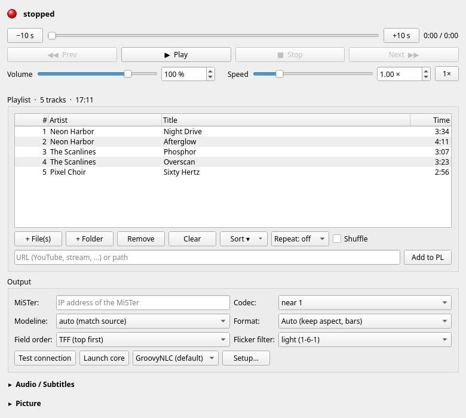
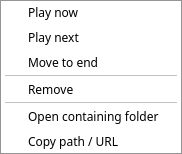
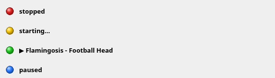
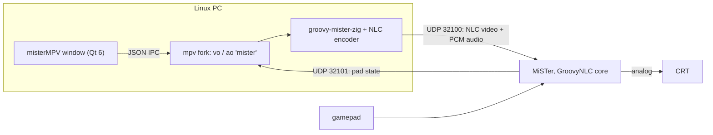

# misterMPV

A media player for the CRT on your MiSTer: [mpv](https://mpv.io) with a video and audio output that streams to a
MiSTer FPGA running the [GroovyNLC core](https://github.com/verbst/Groovy_MiSTer), plus a Winamp-style control window.

[](https://mpv.io)
[](https://github.com/verbst/Groovy_MiSTer)
[](#requirements)
[](#license)



Every video frame is compressed with the GroovyNLC codec and sent over UDP to the MiSTer at the CRT's own timing
(240p, 288p, 480i, 576i); audio is sent as 48 kHz PCM. The MiSTer's gamepad controls the player and shows status text
on the TV.

## Contents

1. [Requirements](#requirements)
2. [Prepare the MiSTer: the GroovyNLC core](#prepare-the-mister-the-groovynlc-core)
3. [Installation](#installation)
4. [First start](#first-start)
5. [Using the player](#using-the-player)
6. [Features](#features)
7. [Screenshots](#screenshots)
8. [How it works](#how-it-works)
9. [Repository layout](#repository-layout)
10. [FAQ](#faq)
11. [Documentation, credits, license](#documentation-credits-license)

## Requirements

**On the MiSTer**

- The **GroovyNLC core** by verbst, installed as described in the next section. It is **essential**: without it there is
  nothing on the MiSTer that can receive the stream. Project and downloads:
  **[github.com/verbst/Groovy_MiSTer](https://github.com/verbst/Groovy_MiSTer)** (releases:
  [verbst/Groovy_MiSTer/releases](https://github.com/verbst/Groovy_MiSTer/releases)).
- A CRT on the analog output, and Gigabit Ethernet between the PC and the MiSTer (a switch is fine, Wi-Fi is not).

**On the PC** (Linux, same LAN as the MiSTer)

- Build tools: `meson` (1.3 or newer), `ninja`, `zig` (0.15.2 or newer, tested with 0.16), `cmake`, Qt 6 base, a C/C++
  compiler, and mpv's usual development libraries (ffmpeg, libass, luajit, ...).
- At runtime: `ffprobe` for tags and durations, optionally `yt-dlp` for YouTube.

Only one program may stream to the MiSTer at a time. Close MiSTerCast, RetroArch, `mister-groovy-relay` or another mpv
first, otherwise the picture stalls.

## Prepare the MiSTer: the GroovyNLC core

misterMPV only talks to the **GroovyNLC** core, a fork of psakhis' Groovy core that adds the near-lossless NLC codec (what
makes 480i/480p stable over Ethernet). The original **Groovy** core ([psakhis/Groovy_MiSTer](https://github.com/psakhis/Groovy_MiSTer))
cannot decode NLC. Everything below is summarised from the core's own
[README](https://github.com/verbst/Groovy_MiSTer#install); check it for newer versions and details.

1. Download the latest release from
   [verbst/Groovy_MiSTer/releases](https://github.com/verbst/Groovy_MiSTer/releases). Copy `GroovyNLC_*.rbf` to
   `/media/fat/_Utility` and `MiSTer_groovyNLC` to `/media/fat` (FTP: binary mode).
2. Add this to `/media/fat/MiSTer.ini` (the section name must be `GroovyNLC`, the core's name, not the file name):

   ```ini
   [GroovyNLC]
   main=MiSTer_groovyNLC
   ```

3. Start the core from the `_Utility` menu. A bouncing logo means it is running and waiting for a client. (Later you
   can start it from misterMPV with **Launch core**, which loads the newest `GroovyNLC_*.rbf` over SSH.)
4. In the core's OSD set **Volatile framebuffer = Off** (required for NLC) and **CRT scale = Off**.

The core listens on UDP **32100** (video, audio, control) and **32101** (controller). Give the PC and the MiSTer static IP
addresses. If the picture stays black or garbled, the core's troubleshooting section lists the usual causes (old
`MiSTer_groovyNLC` binary, Volatile framebuffer on, ...).

Related projects you might know: [verbst/MiSTerCast](https://github.com/verbst/MiSTerCast) (Windows desktop mirroring
with NLC) and [verbst/RetroArch](https://github.com/verbst/RetroArch) (RetroArch with a native MiSTer output).

## Installation

```sh
git clone git@github.com:tdslaine/MisterMPV.git
cd MisterMPV

meson setup build -Dlua=luajit -Dlibmpv=false -Dmanpage-build=disabled -Dtests=false
ninja -C build                                   # player:  build/mpv
cmake -S mister-ui -B mister-ui/build -G Ninja
ninja -C mister-ui/build                         # window:  mister-ui/build/misterMPV
```

The repository is self-contained: the MiSTer protocol library is in `third_party/` and meson builds it on the first
configure (checked from a fresh clone). If meson is not installed: `python3 -m venv v && v/bin/pip install meson`.
After moving the folder, run `meson setup --wipe build` again.

`mister-ui` looks for `mpv` next to itself, then in `../../build/mpv`; `$MPV_MISTER` overrides it. To "install", copy both
binaries into one folder.

## First start

```sh
mister-ui/build/misterMPV
```

1. Enter the MiSTer's IP address under **Output → MiSTer** (or set `$MISTER_HOST`).
2. If the core is not running, press **Launch core** (uses SSH; the login is in **Setup…**, a stock MiSTer is
   `root` / `1`), wait a few seconds, then press **Test connection**.
3. Add media: **+ File(s)**, **+ Folder**, drag files onto the list, or paste a YouTube/stream URL and press
   **Add to PL**.
4. Press **Play**.

Files can also be given on the command line: `misterMPV song.mp3 ~/Music/Album/` adds them and starts playing.

Without the window, the player alone works as well:

```sh
build/mpv --vo=mister --ao=mister --vo-mister-host=<MiSTer IP> --vo-mister-modeline=auto movie.mkv
```

## Using the player

**Transport.** Prev, Play/Pause, Stop, Next; the seek bar has -10 s / +10 s at its ends; volume (up to 130 %) and speed
(0.25x to 4x) below. The coloured lamp shows the state: red stopped, yellow starting, green playing, blue paused.

**Playlist.** A table with `#`, `Artist`, `Title`, `Album` (hidden by default; right-click the header to show it) and
`Time`. Click a header to sort, click again to reverse. Drag rows to reorder, drop files from a file manager onto it.
Right-click a row for *Play now*, *Play next*, *Move to end*, *Remove*, *Open containing folder*, *Copy path*.
`Sort` has artist, title, album, time, folder, date, reverse and random. `Repeat` is off / one / all; `Shuffle` picks
the next track randomly but keeps the list order.

**Output and picture.** Modeline (`auto` follows the source), field order, flicker filter, aspect. In the collapsible
*Audio / Subtitles* and *Picture* sections: track selection, subtitle size and position, visualizer for music;
brightness, contrast, saturation, black level, scanlines (four styles) and **CRT calibration** (picture size and shift
for your set's overscan, with a test pattern). **Setup…** holds the rarely changed options: OSD text size, subtitle
colour, "subtitles in the black bars", artist/title overlay for music, colour order, gamepad on/off, SSH login.

**Keyboard**

| Key | Action |
|---|---|
| `Space`, `C` | play / pause |
| `X` | play (restart) |
| `V` | stop |
| `Z`, `B` | previous, next |
| `M` | mute |
| `Ctrl` + `Left` / `Right` | seek 10 s (with `Shift`: 60 s) |
| `Ctrl` + `Up` / `Down` | volume |
| `Del`, `Enter` (in the list) | remove, play |

**MiSTer gamepad**

| Button | Action |
|---|---|
| D-pad left / right | seek 10 s, hold to scan |
| D-pad up / down | volume |
| B1, Start | pause |
| B2 | quit |
| B3, B4 | next audio track, next subtitle track |
| L1, R1 | previous, next |
| L2, R2 | seek -60 s, +60 s |
| Select | status on the TV |

A button without a function flashes `Pad button 0x....` on the TV, which makes it easy to extend the mapping
(`video/out/mister_pad.c`).

## Features

- Output to the CRT: automatic modeline (25/50 fps to the 50 Hz modes, everything else 60 Hz), TFF/BFF field order,
  flicker filter for interlaced modes, lossless or near-lossless codec.
- Picture: brightness, contrast, saturation, black level, four scanline styles, aspect modes (auto, stretch, zoom, 4:3,
  16:9, 21:9), CRT size/position calibration with a test pattern.
- Gamepad control from the MiSTer with on-screen status.
- Winamp-style playlist: sortable table, drag and drop, recursive folders, right-click menu, shuffle that keeps the order,
  repeat modes, YouTube and stream URLs, SMB/SFTP shares through KDE's kio-fuse.
- Tags, durations and cover-less music handling: `ffprobe` in the background with a cache; artist taken from the folder
  structure when the tag is missing; visualizers (spectrum, waves, vectorscope, spectrogram, bars); permanent
  artist/title overlay.
- Subtitles: size, position, colour, placement in the black bars of letterboxed films.
- Convenience: status lamp, remembered window size, keyboard shortcuts, *Launch core* and *Test connection*.

## Screenshots

| | |
|---|---|
|  |  |
| Playlist, transport and picture controls | Audio, subtitles and visualizer |
|  |  |
| Setup | CRT calibration dialog |
|   |  |
| Right-click menu and sort menu | Status lamp: stopped, starting, playing, paused |

The calibration test pattern as it appears on the CRT (white edge = picture border, yellow and cyan = 95 % and 90 %
safe areas):


## How it works



mpv decodes and scales to the CRT raster and draws subtitles and OSD as usual. `vo_mister` passes each frame to one
sender thread, which repeats the last frame at the CRT's rate, splits interlaced frames into fields (flicker filter
first), applies the picture effects, encodes with NLC and sends it. Because the effects run in that thread, they also
work while paused. The modeline changes by reconnecting; `auto` decides after about eight frames from the source frame
rate and height. The window is a separate Qt program that starts mpv and steers it over its JSON IPC socket; shuffle,
visualizers and the overlay are small Lua scripts compiled into the binary.

## Repository layout

The fork changes only a few lines of mpv; everything else is new files.

| Path | Contents |
|---|---|
| `video/out/vo_mister.c`, `mister_conn.c/.h` | video output, shared sender thread, picture effects |
| `video/out/mister_calib.c/.h` | CRT calibration and test pattern |
| `video/out/mister_pad.c/.h` | gamepad to mpv commands |
| `video/out/nlc_codec.cpp/.h`, `mister_modelines.inc` | NLC encoder, modeline table |
| `audio/out/ao_mister.c` | audio output |
| `player/lua/mister_playlist.lua`, `mister_visualizer.lua` | shuffle, next/previous, visualizer, overlay |
| `mister-ui/` | the Qt window and its screenshots |
| `third_party/groovy-mister-zig/` | MiSTer protocol library (Zig) |
| hooks into mpv | `video/out/vo.c`, `audio/out/ao.c`, `options/options.c/.h`, `player/core.h`, `player/lua.c`, `player/scripting.c`, `meson.build` |

## FAQ

<details>
<summary>Why does this repository contain all of mpv?</summary>

A video or audio output has to live inside the player, and mpv has no plug-in interface for outputs: the ones you know
(`gpu`, `x11`, ...) are compiled into the binary. There are three ways to get "mpv, but the picture goes to a MiSTer":

1. Fork mpv and add `--vo=mister` / `--ao=mister`. This is what we did. Plain `mpv` works with it, and subtitles, OSD,
   scaling, filters, yt-dlp and scripting come for free; audio and video stay in sync inside the player. The price is
   that the repository contains all of mpv.
2. Write an application around `libmpv` and render into memory with its software render API. No fork, but audio has to be
   tapped some other way, the OSD and subtitle path has to be rebuilt, and nothing works from the command line.
3. Keep only our patches in a small repository and fetch mpv in a build script. Slimmer to browse, but every mpv release
   needs patch maintenance and a build takes two steps.

The repository looks large because it carries mpv's history (about 54,000 commits, about 120 MB once). Our own part is
roughly 30 files plus the vendored protocol library, and only a few lines inside mpv, so a new mpv is merged with
`git fetch origin && git merge origin/master`.
</details>

<details>
<summary>The picture stalls ("FPGA stalled, reconnecting")</summary>

Almost always a second sender: MiSTerCast, RetroArch, `mister-groovy-relay` (it probes the MiSTer even while idle) or an
old mpv. Stop it. Otherwise check the IP, whether the core is loaded (use **Launch core**) and whether the network
drops UDP packets.
</details>

<details>
<summary>The colours look blue or red-tinted</summary>

The core expects B,G,R. If a core ever wants R,G,B, change **Setup… → Colour order**.
</details>

<details>
<summary>Does it work with the original Groovy core?</summary>

No. misterMPV streams with the NLC codec, which only the GroovyNLC core decodes.
</details>

<details>
<summary>Windows or macOS?</summary>

Not tested. It is developed and used on Linux. mpv and the Zig library are cross-platform; the Qt window and the kio-fuse
integration are the Linux-specific parts.
</details>

<details>
<summary>How do I update mpv?</summary>

`git fetch origin && git merge origin/master`, then `meson setup --wipe build` and rebuild. Conflicts can only occur in
the few hook lines listed under "Repository layout".
</details>

## Documentation, credits, license

- [MISTER.md](MISTER.md): all options, scripts, gamepad details, window internals.
- [HANDOFF.md](HANDOFF.md): status, decisions, pitfalls and open points. Read it before changing things.
- [CREDITS.md](CREDITS.md): who made what this builds on, with links and licenses.
- [README-mpv.md](README-mpv.md): mpv's own README.

### License

misterMPV is free software under the GPL. mpv is GPLv2 or later (libmpv LGPLv2.1 or later); the vendored
`groovy-mister-zig` and the NLC codec are GPL as well. See `LICENSE.GPL`, `LICENSE.LGPL`, `Copyright` and
`third_party/groovy-mister-zig/LICENSE`.

### Credits

Built on mpv, psakhis' Groovy_MiSTer, verbst's GroovyNLC core and NLC codec, iequalshane's MiSTerCast, dylan's
groovy-mister-zig, idio-sync's MiSTer_GroovyRelay (flicker filter and calibration ideas) and jedisct1's zig-lz4, with
FFmpeg, libass, LuaJIT, Qt, Zig and yt-dlp. Full list: [CREDITS.md](CREDITS.md). "Winamp" is a trademark of its owner;
this project is only inspired by its layout. Developed with the help of Claude Code (Anthropic).
