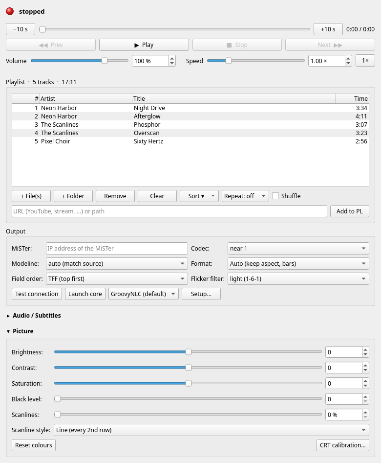

# misterMPV

**A media player for the MiSTer FPGA's CRT output.** misterMPV is [mpv](https://mpv.io) with a video and
audio output that streams straight to a MiSTer running the *GroovyNLC* core (video as GroovyNLC-compressed
frames at the CRT's own timing, audio as 48 kHz PCM), plus a Qt control window built like a classic
Winamp: playlist table, transport buttons, volume/speed, picture controls, CRT calibration, visualizers
and gamepad control from the MiSTer's own controller.



> This repository is a **fork of mpv v0.41.0**. Everything of ours is small and listed in
> [Where our code lives](#where-our-code-lives); the rest is plain mpv
> ([README-mpv.md](README-mpv.md)).

## What you need

- A **MiSTer** with the **GroovyNLC** core (`/media/fat/_Utility/GroovyNLC_*.rbf`) and a CRT on its analog
  output. Core OSD options: *Volatile framebuffer = Off*, *CRT scale = Off*.
- A Linux PC on the same LAN. Build tools: `meson` (>= 1.3), `ninja`, `zig` (>= 0.15.2, tested 0.16.0),
  `cmake` + Qt6 base, a C/C++ compiler and mpv's usual development libraries (ffmpeg, libass, luajit,
  pipewire, ...). `ffprobe` is used at runtime for playlist tags and durations.
- Only one sender per MiSTer at a time: close MiSTerCast, RetroArch, `mister-groovy-relay` or another mpv
  first, otherwise the FPGA stalls.

## Build

```sh
meson setup build -Dlua=luajit -Dlibmpv=false -Dmanpage-build=disabled -Dtests=false
ninja -C build                                           # -> build/mpv
cmake -S mister-ui -B mister-ui/build -G Ninja && ninja -C mister-ui/build   # -> mister-ui/build/misterMPV
```

Everything needed is in the repo (the MiSTer protocol library lives in `third_party/groovy-mister-zig` and is
built by meson on the first configure). Verified from a fresh `git clone`. No system meson? `python3 -m venv v
&& v/bin/pip install meson`. After moving the folder: `meson setup --wipe build`.

## Run

```sh
mister-ui/build/misterMPV                 # the player window
mister-ui/build/misterMPV song.mp3 ~/Music/Album/    # add files/folders and play
```

First start: type the MiSTer's IP into **Output → MiSTer**, press **Test connection** (the core must be
running; **Launch core** loads GroovyNLC over SSH, login in **Setup…**), add some files, press **Play**.
`mister-ui` finds `mpv` next to itself, then in `../../build/mpv`, or via `$MPV_MISTER`; the host can also
come from `$MISTER_HOST`.

Without the window, plain mpv works too:

```sh
build/mpv --vo=mister --ao=mister --vo-mister-host=<MiSTer IP> --vo-mister-modeline=auto movie.mkv
```

## What it does

- **Video/audio to the MiSTer**: `auto` modeline (25/50 fps -> 50 Hz family, everything else 60 Hz; 240p and
  480i/576i), field order TFF/BFF, flicker filter for interlaced modes, NLC codec lossless or near 1-3.
- **Picture**: brightness, contrast, saturation, black level, scanlines (4 styles), CRT size/position
  calibration with a test pattern, aspect (auto/stretch/zoom/4:3/16:9/21:9).
- **Subtitles / audio**: track selection, size, position, colour, "subtitles in the black bars", artist/title
  overlay for music, volume (to 130 %), speed (0.25-4x).
- **Playlist** like Winamp: table with `# | Artist | Title | Album | Time` (clickable headers), tags and
  durations via ffprobe (cached), artist fallback from the folder structure, repeat off/one/all, shuffle that
  keeps the list order, sort menu (artist, title, album, time, folder, date, reverse, random), drag & drop,
  right-click menu (play now/next, move to end, remove, open folder, copy path), folders added recursively,
  YouTube/stream URLs, network shares via KDE kio-fuse.
- **Audio-only files**: optional visualizer on the CRT (spectrum, waves, vectorscope, spectrogram, bars).
- **Gamepad on the MiSTer** controls playback; the status shows on the TV (see below).
- **Status LED** (green playing, blue paused, red stopped, yellow starting), window size is remembered.

## Controls

| Keyboard | |
|---|---|
| `Space` / `C` | play / pause |
| `X` | play (restart) |
| `V` / `Z` / `B` | stop / previous / next |
| `M` | mute |
| `Ctrl+Left/Right` (+`Shift`) | seek 10 s (60 s) |
| `Ctrl+Up/Down` | volume |
| `Del` / `Enter` in the list | remove / play |

| MiSTer gamepad | |
|---|---|
| D-pad left/right | seek 10 s, hold = scan |
| D-pad up/down | volume |
| B1 / Start | pause |
| B2 | quit |
| B3 / B4 | next audio / subtitle track |
| L1 / R1 | previous / next entry |
| L2 / R2 | seek -/+ 60 s |
| Select | status on the TV (unmapped buttons show their code) |

## Where our code lives

| Path | What |
|---|---|
| `video/out/vo_mister.c`, `mister_conn.c/.h` | video output, shared sender thread, picture effects |
| `video/out/mister_calib.c/.h` | CRT size/position calibration + test pattern |
| `video/out/mister_pad.c/.h` | gamepad -> mpv commands |
| `video/out/nlc_codec.cpp/.h`, `mister_modelines.inc` | NLC encoder, modeline table |
| `audio/out/ao_mister.c` | audio output |
| `player/lua/mister_playlist.lua`, `mister_visualizer.lua` | shuffle/next/prev, visualizer, artist/title overlay (built in) |
| `mister-ui/` | the Qt control window |
| `third_party/groovy-mister-zig/` | MiSTer protocol library (zig) |
| small hooks | `video/out/vo.c`, `audio/out/ao.c`, `options/options.c/.h`, `player/{core.h,lua.c,scripting.c}`, `meson.build` |

More: [MISTER.md](MISTER.md) (options and technical reference), [HANDOFF.md](HANDOFF.md) (status, decisions,
open points - read this before changing things).

## Related

- **MiSTerCast** (Linux screen/media cast to the same core) - this player started as its sibling.
- **groovy-mister-zig** (vendored here) is the protocol library from
  [dylan/groovy-mister-zig](https://github.com/dylan/groovy-mister-zig) with local NLC/input changes.

## License

mpv is GPLv2+/LGPL (see `LICENSE.GPL`, `LICENSE.LGPL`, `Copyright`); `nlc_codec` and our additions are GPL.
